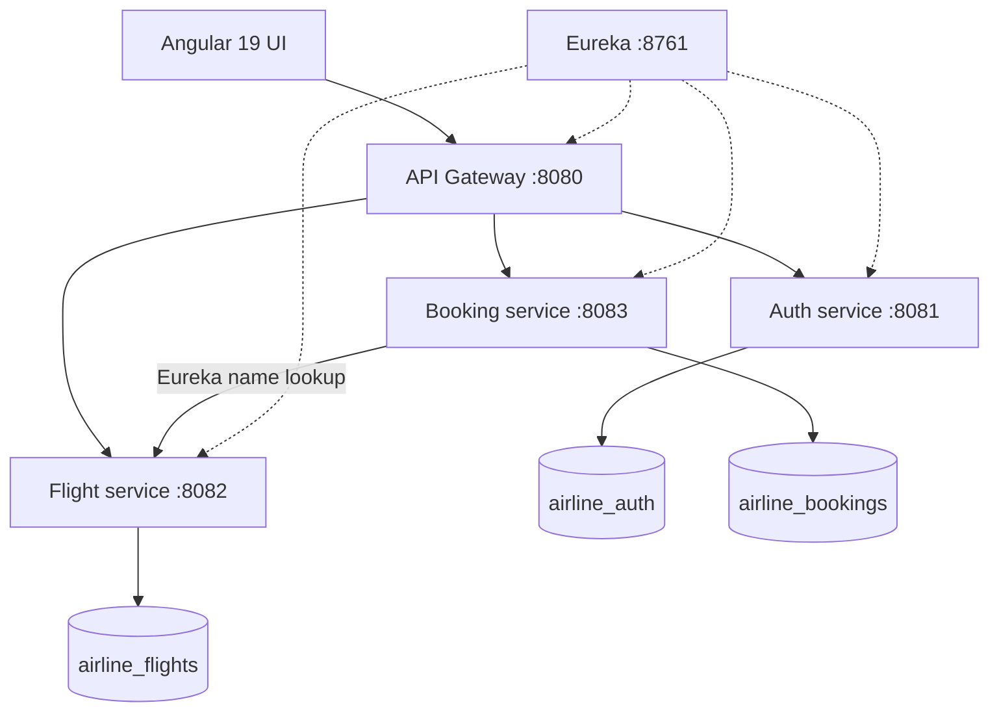

# Airline Management System — Complete Implementation Plan

> **Purpose:** A compact, beginner-friendly, professional-style full-stack student project with exactly three business microservices. This document is the source-of-truth for scope, architecture, ownership, local development, demo setup, and acceptance tests.
>
> **Status (3 November 2026):** The project-local toolchain is installed and checked: Temurin JDK 17.0.12, Maven 3.9.14, Node 22.9.0/npm 10.8.3, Angular CLI 19.2.27, and Angular framework 19.2.25. MySQL Server 8.0.46 runs from `.tools`. **Verified:** `scripts/package-demo.ps1` builds the Angular site and all five Maven applications; all six backend unit tests pass; the Angular production build passes; all three database services start and apply migrations; Eureka registers the services; Gateway serves the packaged Angular app, Swagger, and all three API definitions. Live API/UI checks cover profile validation and editing, customer-only directory search, admin booking filters and role restrictions, flight search, booking creation/cancellation, duplicate-seat and capacity validation, and seat release. Admin tables and filters were checked at a narrow viewport; admin flight links follow the user's role. Two demo-startup/validation issues found during live checks were fixed: internal date-conversion errors now retain HTTP 400, and Eureka/Gateway refresh discovery data every five seconds. The temporary QA booking was removed, the profile name restored, and the eight flights, two demo accounts, and three pre-existing cancelled booking rows were preserved. **Still to verify on a separate presentation laptop:** run `scripts/check-laptop.ps1` and repeat the setup/demo there.

## 1. Project goal and non-goals

Build an airline reservation demo that supports user registration/login, customer name updates, public flight search, individual seat booking, booking history/cancellation, and administrator flight, customer, and booking views. Show MVC, HTTP REST APIs, Maven, Spring JPA, role-based JWT security, API Gateway, Eureka, MySQL, Angular reactive forms, validation, and Swagger OpenAPI.

**Keep it intentionally small:** no payments, check-in, baggage, emails, Kafka, Redis, Docker, Kubernetes, central config server, or elaborate UI frameworks. All source should be teachable by seven beginners. This is a **production-inspired teaching app**, not a production airline system.

## 2. Hardware and exact target-toolchain requirements

The intended presentation laptop has:

| Item | Requested/observed version | Decision |
|---|---|---|
| JDK | **OpenJDK 17.0.12** | Target Java 17 bytecode and APIs; use `java.version=17` in Maven. |
| Angular CLI | **19.2.27** | Pin the project-local CLI and build tools to **19.2.27**. Run `npx ng version` inside `airline-frontend`. |
| Angular framework | Latest published 19.2 patch | Pin Angular runtime/compiler packages to **19.2.25**. The requested CLI patch 19.2.27 exists; framework packages at 19.2.27 are not published. |
| npm | **10.8.3** | Bundled with Node.js 22.9.0. |
| Node.js | **22.9.0** | Angular 19.2's compatibility range includes Node 22.0.0 and later within 22.x. This is an older, unsupported Angular major retained to match the classroom laptop. |
| Maven | Not specified | Use project-local Maven **3.9.14** with Java 17. |
| Database | MySQL Server 8.0 (tested on 8.0.46); MySQL Workbench optional | One local MySQL process, three schemas. |

**Classroom-only constraint:** Angular 19.2 is out of support. `npm audit --omit=dev` reports six vulnerabilities in the pinned Angular 19.2.25 runtime packages (four high, two moderate); the available remediation requires a major Angular upgrade. This exact laptop-compatible toolchain is suitable for an isolated local demonstration only. Upgrade Node and Angular before exposing the app to a network.

**Important:** The coding workspace is not a remote-control session on the presentation laptop. Installing software in this workspace does **not** install it on that laptop. The laptop installation must happen there (or after providing a connected execution environment). The clean project package and running services were checked with the project-local JDK **17.0.12**, matching the requested Java patch.

### Windows laptop installation and verification

1. Confirm your existing JDK 17.0.12: `java -version`, `javac -version`, and `where java`. Ensure `JAVA_HOME` points to the JDK, not an old JRE.
2. Run `powershell -ExecutionPolicy Bypass -File scripts/setup-local-tools.ps1`. It downloads portable Node.js 22.9.0 (npm 10.8.3), Temurin JDK 17.0.12, and Maven 3.9.14 into `.tools` without changing machine-wide PATH settings.
3. Load them into the current PowerShell with `. .\scripts\use-local-tools.ps1`; verify `java -version`, `node -v`, `npm -v`, and `mvn -version`.
4. If MySQL Server is absent, run `powershell -ExecutionPolicy Bypass -File scripts/setup-local-mysql.ps1`; it downloads and initializes MySQL 8.0.46 under `.tools` without registering a Windows service. Start it in a separate PowerShell window with `powershell -ExecutionPolicy Bypass -File scripts/start-local-mysql.ps1`. On first start, set local user `root` to password `password` using the `mysql.exe` command shown by the setup script. Workbench is optional; the separate **MySQL Server** must run.
5. From `airline-frontend`, run `npm ci`, then `npx ng version` to verify project-local **Angular CLI 19.2.27 / Angular 19.2.25**. Global CLI versions do not affect the local `npx` command.

## 3. Architecture



Exactly **three business services**: Auth, Flight, Booking. Gateway and Eureka are lightweight supporting Java applications. **Five Spring Boot JVM processes** run in total, plus MySQL and (during frontend development) Node.js. In demo mode Angular can be built to static files and hosted by Gateway, eliminating the Node dev-server process.

Backend structure per service: `controller → service interface → service implementation → repository → database`, with `entity`, `domain` enums, `dto`, `security`, `@RestControllerAdvice`, Flyway migration and small unit tests where needed. Controllers depend on the service interface; each microservice has one implementation. Use constructor injection and `record` DTOs. Persist enums by name so existing VARCHAR columns and API values remain compatible.

### Service responsibilities

| Component | Owns | Does not own |
|---|---|---|
| Auth | User records, BCrypt password hashes, login, JWT signing, name-only profile updates, admin customer directory | Flights or bookings |
| Flight | Flight schedule, origin/destination, price, capacity, OPEN/CLOSED sales status | Users or seat reservations |
| Booking | One-seat bookings, occupied-seat uniqueness, cancellation, fare snapshot, admin read-only booking report | Flight master data or passwords |
| Gateway | Public routing, CORS, single Swagger UI with three API definitions | Persistence or business rules |
| Eureka | Service registry and discovery | Business data |

## 4. Database schema (one MySQL server, three schemas)

All IDs are BIGINT; dates are **UTC**, and prices use DECIMAL rather than floating point.

**`airline_auth.users`**

| Field | Type / rule |
|---|---|
| `id` | BIGINT AUTO_INCREMENT PK |
| `name` | VARCHAR(100) NOT NULL |
| `email` | VARCHAR(150) NOT NULL UNIQUE |
| `password_hash` | VARCHAR(255) NOT NULL (BCrypt) |
| `role` | VARCHAR(20) NOT NULL; `CUSTOMER` or `ADMIN` |
| `created_at` | DATETIME NOT NULL |

**`airline_flights.flights`**

| Field | Type / rule |
|---|---|
| `id` | BIGINT AUTO_INCREMENT PK |
| `flight_number` | VARCHAR(20) NOT NULL |
| `origin`, `destination` | VARCHAR(100) NOT NULL |
| `departure_time`, `arrival_time` | DATETIME NOT NULL |
| `price` | DECIMAL(10,2) NOT NULL, greater than 0 |
| `capacity` | INT NOT NULL, 1–300 |
| `status` | VARCHAR(20) NOT NULL; `OPEN` or `CLOSED` |
| constraint | UNIQUE (`flight_number`, `departure_time`) |

**`airline_bookings.bookings`**

| Field | Type / rule |
|---|---|
| `id` | BIGINT AUTO_INCREMENT PK |
| `user_id` | BIGINT NOT NULL (logical Auth reference) |
| `flight_id` | BIGINT NOT NULL (logical Flight reference) |
| `seat_number` | INT NOT NULL |
| `fare_at_booking` | DECIMAL(10,2) NOT NULL |
| `status` | VARCHAR(20) NOT NULL; `CONFIRMED` or `CANCELLED` |
| `booked_at` | DATETIME NOT NULL |

**`airline_bookings.seat_allocations`**

| Field | Type / rule |
|---|---|
| `booking_id` | BIGINT PK and FK to local `bookings.id` |
| `flight_id` | BIGINT NOT NULL |
| `seat_number` | INT NOT NULL |
| constraint | UNIQUE (`flight_id`, `seat_number`) |

Cross-service references are **not** SQL foreign keys. A booking and its seat-allocation insert happen in one Booking database transaction; a duplicate seat is rejected by MySQL's unique constraint (409). Cancellation preserves booking history but removes its allocation. Flight capacity and schedule are immutable after creation in this compact design; admin may edit ticket price or close/open sales. A closed flight stops new reservations but does not retroactively cancel previous ones.

## 5. Public API contract

All frontend calls use **`http://localhost:8080`**. Individual services are on 8081–8083. Swagger is intended at **`http://localhost:8080/swagger-ui/index.html`** with three document selections.

| Method | Route | Access | Meaning |
|---|---|---|---|
| POST | `/api/auth/register` | Public | Create CUSTOMER |
| POST | `/api/auth/login` | Public | Return JWT, name, role |
| GET | `/api/auth/me` | Authenticated | Current identity |
| PATCH | `/api/auth/me` | Authenticated | Update the current user's name; email and role stay fixed |
| GET | `/api/auth/admin/customers?search=` | ADMIN | Search customer summaries (ID, name, email, join date); no password data |
| GET | `/api/flights?origin=&destination=&date=` | Public | Search available future flights |
| GET | `/api/flights/{id}` | Public | One flight |
| GET | `/api/flights/manage` | ADMIN | All flights, including closed sales |
| POST | `/api/flights` | ADMIN | Add flight |
| PATCH | `/api/flights/{id}` | ADMIN | Update price / OPEN/CLOSED |
| GET | `/api/bookings/seats?flightId=1` | Public | Occupied seat numbers |
| POST | `/api/bookings` | CUSTOMER | Book one seat |
| GET | `/api/bookings/me` | CUSTOMER | Only current user's bookings |
| PATCH | `/api/bookings/{id}/cancel` | CUSTOMER | Cancel owned booking |
| GET | `/api/bookings/admin?flightId=&status=` | ADMIN | Read-only booking report, optionally filtered by flight and status |

Response statuses: 200/201 success, 400 invalid input, 401 missing/invalid token, 403 wrong role, 404 missing resource, 409 duplicate email/seat or repeated cancellation, 503 Flight-service unavailable. Profile updates accept a nonblank name of at most 100 characters. Admin search results include customer-only safe fields; the admin booking report exposes the customer ID and booking details without a cross-service database join. Use compact JSON error messages.

**JWT:** Auth signs RSA (RS256) JWTs. Other services verify the public key, expiration and role. Only Auth has the private key. Generate local keys once using `java tools/GenerateKeys.java`; `keys/` stays out of source control. The customer ID comes from the validated token, never a browser-supplied user ID. Registration cannot supply role. Token storage in `sessionStorage` is an educational simplification; stronger session/cookie protections would be required for a public deployment.

## 6. Validation rules

| Feature | Backend must enforce | Angular UX checks |
|---|---|---|
| Registration | Valid email, unique email, non-empty name, min 8 password | Required/email/length inline warnings |
| Login | Matching BCrypt password | Required fields + visible auth error |
| Flights | Different origin/destination, future departure, arrival after departure, positive fare, capacity 1–300 | Required fields, date comparison, numeric limits |
| Booking | Flight OPEN and future, seat in capacity, unique active allocation | Available seats and numeric input |
| Cancellation | Booking exists, belongs to JWT subject, CONFIRMED | Confirmation and refreshed history |
| Customer profile | Name is nonblank and at most 100 characters; email and role are not editable | Required/max-length checks, visible save feedback |
| Admin reports | Customer directory is limited to CUSTOMER records; flight filter is a positive whole ID; status is a known enum | Search/empty states, invalid filter feedback |

Use Jakarta Bean Validation on request DTOs and business-rule checks in services. Backend security is authoritative even if Angular hides an admin control.

## 7. Angular UX specification

Page groups: (1) Login/Register, (2) Search Flights, (3) Seat Selection, (4) My Bookings, (5) Customer Profile, (6) Admin dashboard with Flights, Customers, and Bookings tabs. Standalone Angular components, Reactive Forms, one HTTP interceptor, two route guards, typed models and status unions, simple HttpClient calls, and a reusable responsive confirmation modal for booking, cancellation, and flight-sales changes. Every Angular component keeps its TypeScript, HTML template, and component CSS in separate sibling files. Admin tables scroll horizontally on narrow screens. Visual theme: white panels, #f8f9fb background, consistent 8/16/24px spacing, light-gray borders, restrained blue action color, accessible labels, responsive stacked layouts, loading/empty/error states. Avoid charts, UI kits, animation dependencies, or clutter.

Basic journey: customer login → edit name in My Profile → list flights → choose a future flight → select seat → confirm → My Bookings → cancel. Admin journey: login → add a flight → close/reopen sales → inspect Customers and search by name/email → filter Bookings by flight/status.

## 8. Demo seed data (automatic)

The Auth service creates two example accounts **only if their email does not already exist**:

| Role | Email | Local demo password |
|---|---|---|
| ADMIN | `admin@airline.test` | `Admin@12345` |
| CUSTOMER | `customer@airline.test` | `Customer@12345` |

The passwords are hashed with BCrypt before storage. Override via `DEMO_ADMIN_PASSWORD` and `DEMO_CUSTOMER_PASSWORD` environment variables. **Never use these public demo passwords outside a local classroom environment.**

The Flight service seeds eight examples when the `flights` table is empty:

| Number | Origin | Destination | Fare (INR) |
|---|---|---|---:|
| AI101 | Delhi | Mumbai | 4,500 |
| 6E202 | Delhi | Bengaluru | 5,200 |
| UK303 | Mumbai | Delhi | 4,800 |
| AI404 | Delhi | Hyderabad | 3,900 |
| 6E505 | Bengaluru | Chennai | 3,100 |
| AI606 | Mumbai | Goa | 2,800 |
| UK707 | Delhi | Kolkata | 4,600 |
| 6E808 | Hyderabad | Delhi | 4,200 |

Each has **30 seats** and departs 3–5 days after the **first fresh database startup**, with two-hour example durations. The rows persist across app restarts; they are **not** re-dated after the initial seed. For a much later presentation, create fresh sample flights via Admin or initialize a fresh database. A booking is deliberately **not** pre-seeded with arbitrary cross-service user and flight IDs, because that could associate someone else's booking with an incorrect identity; it takes only a few seconds to create a real booking from the seeded customer account.

## 9. Local build and start

Run commands from the project root unless otherwise noted.

1. Check Java 17 / Maven / Node / npm versions, and confirm MySQL Server 8.0 is running on port 3306 with `root` / `password`.
2. In Workbench, run `database/create-databases.sql`. Each service additionally has a `createDatabaseIfNotExist=true` JDBC URL for local convenience; Flyway creates the tables on first start.
3. Create JWT key pair **once**: `java tools/GenerateKeys.java`.
4. Build backend: `mvn clean package`.
5. In `airline-frontend`, run `npm ci` and `npx ng version` to verify CLI 19.2.27 / Angular 19.2.25.
6. Start, in this order, **in five terminals from the root directory**:

```powershell
java -Xms64m -Xmx192m -jar discovery-server/target/discovery-server-1.0.0.jar
java -Xms64m -Xmx192m -jar auth-service/target/auth-service-1.0.0.jar
java -Xms64m -Xmx192m -jar flight-service/target/flight-service-1.0.0.jar
java -Xms64m -Xmx256m -jar booking-service/target/booking-service-1.0.0.jar
java -Xms64m -Xmx192m -jar api-gateway/target/api-gateway-1.0.0.jar
```

7. For frontend development, in `airline-frontend`: `npm start`; browse **`http://localhost:4200`**. This uses the Angular proxy to reach Gateway on 8080.
8. View **Eureka** `http://localhost:8761` and **Swagger** `http://localhost:8080/swagger-ui/index.html`.

### Lightweight presentation option (no Node dev server)

On Windows, run **`powershell -ExecutionPolicy Bypass -File scripts/package-demo.ps1`** from the project root. This installs local Angular dependencies from the lockfile, generates keys if missing, builds the Angular app, copies the **contents** of `dist/airline-frontend/browser` into `api-gateway/src/main/resources/static`, and builds all five JARs. Browse `http://localhost:8080` after starting the Java services. The app uses hash-based Angular routing so static hosting needs no separate route fallback. **Verify static serving through the Gateway before your presentation**; it is not necessary for normal development.

The heap numbers above are starting limits, not total RAM consumption. Keep Workbench closed during the demo if memory is tight, and start it briefly when demonstrating schema persistence. On a very low-RAM laptop, measure actual JVM and MySQL usage rather than assuming `-Xmx` equals process RSS.

## 10. Seven-person ownership plan

| Member | Professional role | Primary source files / demonstration |
|---|---|---|
| 1 | Technical Lead / Platform | Root `pom.xml`, `discovery-server/**`, `api-gateway/**`, build/start documentation. Show Eureka, gateway routes and Swagger. |
| 2 | Auth Backend | `auth-service/**`: `AuthController`, `AuthService`, `User`, `UserRepository`, `JwtConfig`, `SecurityConfig`, DTOs, seed users. Show token/role guards, name-only profile update, and safe customer search. |
| 3 | Flight Backend | `flight-service/**`: `FlightController`, `FlightService`, `Flight`, repository, DTOs, Flyway schema, example flights. Show Swagger + database. |
| 4 | Booking Backend | `booking-service/**`: `BookingController`, `BookingService`, `Booking`, `SeatAllocation`, repositories, service client. Show atomic seat reservation/cancel and the admin report filters. |
| 5 | Angular Core & Auth | `airline-frontend/src/app/core/**`, `features/auth/**`, `features/profile/**`, `app.routes.ts`, `app.component.ts`. Show login, interceptor, profile editing and guarded pages. |
| 6 | Angular Flights & UI | `features/flights/**`, `features/admin/**`, `src/styles.css`. Show search, admin flight/customer/booking tabs, responsive tables and filters. |
| 7 | Angular Booking & QA | `features/bookings/**`, `database/**`, `qa/**`. Show booking UI and end-to-end verification evidence. |

Each member works in an own feature branch and requests review before merging; feature owners own related test files. Avoid concurrent edits to shared `pom.xml`/`styles.css` without coordination. Professors should be able to ask any member to explain their owned controller/component and its flow to persistence or API.

## 11. Build stages and acceptance gates

1. **Foundation:** root Maven modules compile; Eureka starts; all clients register; Gateway proxy works; MySQL schemas created.
2. **Auth + Flight:** login and JWT, customer creation, admin-only flight write, seeded flights, Swagger docs.
3. **Booking:** a real booking is made; two simultaneous attempts on same seat yield one success and one 409; cancellation frees seat.
4. **Angular:** all five page groups call Gateway, validation/errors shown and align properly on phone and laptop widths.
5. **Final QA:** backend tests and Angular production build pass; database and service restart behavior checked; use `qa/demo-checklist.md` for classroom scenario.

### Minimum tests

- Registration validation and duplicate email; BCrypt login.
- Missing JWT → 401; customer using admin route → 403.
- Customer can update their own name but not email/role; blank or overlong names → 400.
- Admin customer search returns customers only, supports case-insensitive name/email matching, and never returns password hashes.
- Admin booking report returns booking rows, combines flight/status filters, rejects invalid filters, and is forbidden to customers.
- Invalid cities/dates/prices → 400; unknown flight → 404.
- Confirmed seat uniqueness on concurrent booking attempts → 409 on loser.
- Cancelled seat becomes available; wrong user's booking cannot be cancelled.
- Service outage returns an understandable 503.
- Swagger can call the same Gateway APIs used by Angular.
- `mvn test` succeeds, `npm run build` succeeds, `java -version` on laptop reports 17.0.12.

## 12. Honest limitations and follow-up work

This application demonstrates a **useful small subset** of professional practice: clear ownership, validation, JWT, JPA, migrations, data constraints, separation of services, and a documented build. It does not yet provide production-grade distributed reservation guarantees, persistent refresh tokens, observability/tracing, payment handling, seat holds/expiration, backups, hardened user/session lifecycle, or operational auditing. Never use the demo credentials or development root database account in production. For a class demonstration, these deliberate limits are preferable to unverifiable complexity.

### Reference documentation

- [Spring Cloud / Spring Boot compatibility](https://spring.io/projects/spring-cloud/)
- [Spring Cloud Gateway Server MVC](https://docs.spring.io/spring-cloud-gateway/reference/spring-cloud-gateway-server-webmvc.html)
- [Spring Security Resource Server JWT](https://docs.spring.io/spring-security/reference/servlet/oauth2/resource-server/jwt.html)
- [Spring Data JPA](https://docs.spring.io/spring-data/jpa/reference/)
- [Springdoc OpenAPI](https://springdoc.org/)
- [Angular version compatibility](https://angular.dev/reference/versions)
- [Angular Reactive Forms](https://angular.dev/guide/forms/reactive-forms)
- [MySQL Workbench](https://dev.mysql.com/doc/workbench/en/)

## 13. Companion project guides

- [Architecture and project map](PROJECT_ARCHITECTURE.md): visual architecture, request flows, database ER diagram, API contracts, Angular routes, and repository layout.
- [Beginner code walkthrough](CODE_WALKTHROUGH.md): file-by-file source links, statement-order explanations of important code paths, validation/security concepts, and interview practice.
- [Setup and demo guide](SETUP_AND_DEMO_GUIDE.md): install pinned tools, set up MySQL, run from Command Prompt/Eclipse/VS Code, and follow the demo checklist.
