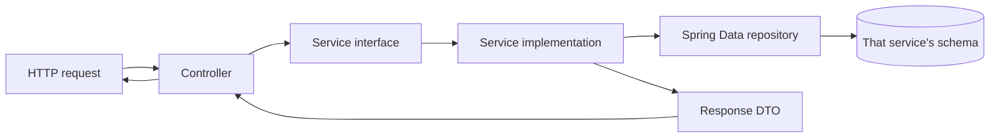
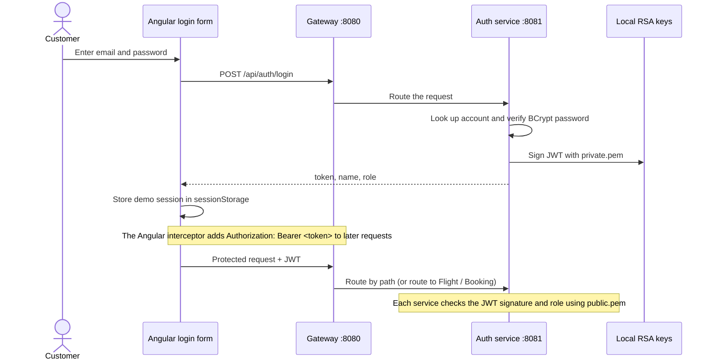
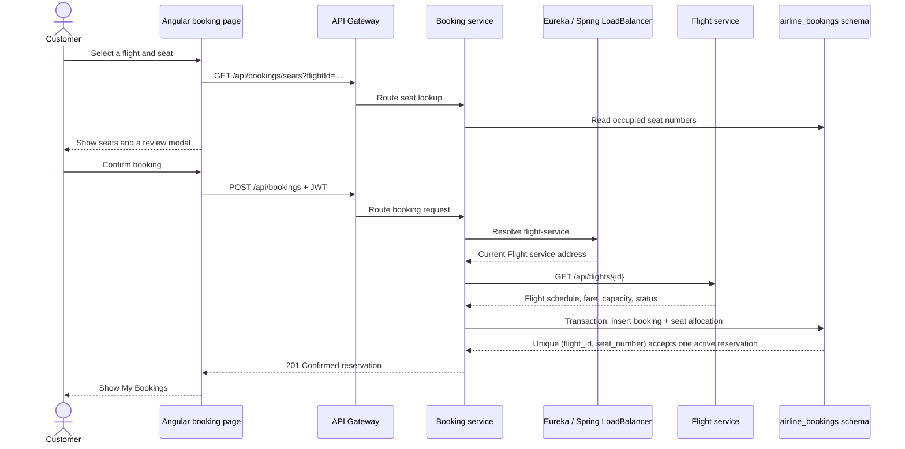
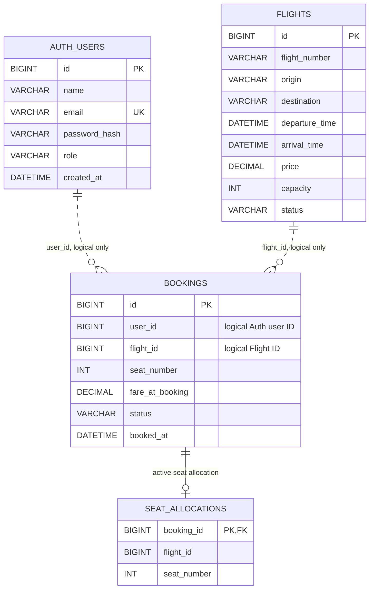
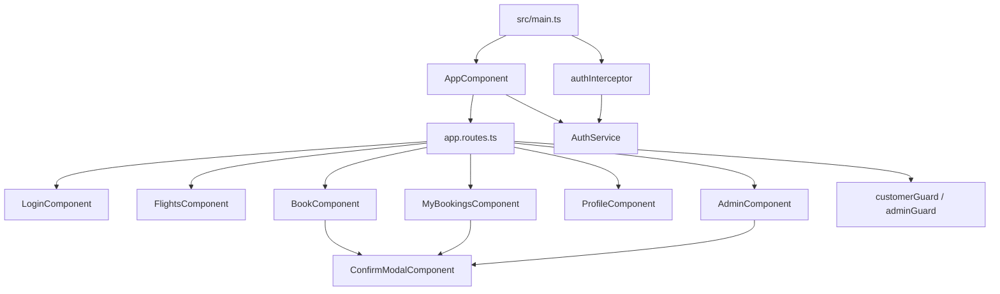

# AirlineMS — Architecture and Project Map

This guide is the visual map of the classroom Airline Management System. It describes the code currently in this folder: Angular 19, Java 17, Spring Boot, MySQL 8, Eureka, and an API Gateway.

## At a glance

The browser talks to one public entry point, the API Gateway. The Gateway serves the built Angular app and routes `/api/...` requests to one of three business services. Each business service owns its own MySQL schema. Booking asks Flight for flight details; it does not read Flight's database directly.

```mermaid
flowchart LR
  Person[Customer or admin] --> Browser[Browser]
  Browser -->|HTML, CSS, JavaScript| UI[Angular app]
  UI -->|HTTP /api requests + optional Bearer JWT| GW[API Gateway :8080]

  GW -->|/api/auth/**| AUTH[Auth service :8081]
  GW -->|/api/flights/**| FLIGHT[Flight service :8082]
  GW -->|/api/bookings/**| BOOK[Booking service :8083]

  AUTH -->|JPA + Flyway| DBA[(airline_auth)]
  FLIGHT -->|JPA + Flyway| DBF[(airline_flights)]
  BOOK -->|JPA + Flyway| DBB[(airline_bookings)]
  BOOK -->|find flight-service by name| DISC[Booking's Flight client]
  DISC -->|GET /api/flights/{id}| FLIGHT

  REG[Eureka registry :8761] -. registers / discovers .-> GW
  REG -. registers / discovers .-> AUTH
  REG -. registers / discovers .-> FLIGHT
  REG -. registers / discovers .-> BOOK
```

The application has **three business microservices** plus two small platform applications: Eureka and Gateway. Running the whole backend means five Java processes. MySQL is a sixth process. The presentation package serves Angular as static files from Gateway, so it does not need the Angular development server.

## Runtime ports

| Address | Process | What it does |
|---|---|---|
| `http://localhost:8080` | API Gateway | Demo website and the single public API entry point. |
| `http://localhost:8080/swagger-ui/index.html` | Swagger UI through Gateway | Interactive API documentation for Auth, Flight, and Booking. |
| `http://localhost:8761` | Eureka | Shows which Spring services have registered. |
| `http://localhost:8081` | Auth service | Internal service port for login, users, profile, and customer search. |
| `http://localhost:8082` | Flight service | Internal service port for flight search and admin flight changes. |
| `http://localhost:8083` | Booking service | Internal service port for seats and reservations. |
| `127.0.0.1:3306` | MySQL Server | Stores the three service databases. |
| `http://localhost:4200` | Angular dev server, optional | Development-only UI with a proxy to Gateway port 8080. |

Use port **8080** for the normal presentation. The three service ports are useful for debugging; the frontend is configured to call Gateway instead.

## Who owns each kind of data?

| Service | Owns | Main files |
|---|---|---|
| Auth | Accounts, BCrypt password hashes, login, signed JWTs, name-only profile editing, safe customer summaries. | `auth-service/.../controller`, `service`, `entity`, `repository`, `security`, `dto`. |
| Flight | Flight number, route, schedule, fare, seat capacity, open/closed sales state. | `flight-service/.../controller`, `service`, `entity`, `repository`, `domain`, `dto`. |
| Booking | Customer's reservation, fare snapshot, cancellation state, unique active seat allocation, admin reservation report. | `booking-service/.../controller`, `service`, `entity`, `repository`, `config`, `domain`, `dto`. |
| Gateway | Routes, CORS for the optional dev server, bundled Angular static files, one Swagger page. | `api-gateway/src/main`. |
| Eureka | In-memory list of service names and their active addresses. | `discovery-server/src/main`. |

Inside each business service, the usual path is:



The controller handles HTTP details; the service owns business rules; the repository reads and writes data. DTOs are the shapes sent through the API. Controllers depend on service interfaces so their code does not need to know how the work is implemented.

## Customer login and role security



Only Auth has the private signing key. Flight and Booking verify tokens with the public key. The browser's route guards improve navigation, but backend Spring Security is the actual access control. A user ID used for “my bookings” comes from the verified JWT subject, not from a user ID typed into the request.

## Booking and cancellation flow



Cancellation marks the booking `CANCELLED` and removes its row from `seat_allocations` in one database transaction. The booking remains for history and admin reporting; the seat can be booked again. A duplicate active seat is blocked by MySQL's unique constraint and reported as HTTP 409.

## Database map

There is one MySQL server and three separate schemas. **Dotted links in the diagram are logical IDs only; they are not cross-schema foreign keys.**



| Schema / table | Important rules |
|---|---|
| `airline_auth.users` | Unique email; password stored as BCrypt hash; role is `ADMIN` or `CUSTOMER`. |
| `airline_flights.flights` | Positive fare; capacity from 1 to 300; unique flight number plus departure time; status `OPEN` or `CLOSED`. |
| `airline_bookings.bookings` | Stores the fare at time of booking so later price changes do not change the old receipt. Status `CONFIRMED` or `CANCELLED`. |
| `airline_bookings.seat_allocations` | One row per currently allocated seat; unique flight plus seat; row is removed on cancellation. |

Each service has one Flyway SQL migration under its `src/main/resources/db/migration` folder. Flyway creates the service's tables on first startup. Hibernate is set to `validate`, which checks that entity mappings match those tables instead of silently changing the schema.

## HTTP API contract

All routes below are called through `http://localhost:8080`. Protected routes use the header `Authorization: Bearer <JWT>`.

### Authentication and profiles — Auth service

| Method and path | Access | Purpose / request |
|---|---|---|
| `POST /api/auth/register` | Public | Create a customer. JSON: `{ "name", "email", "password" }`. |
| `POST /api/auth/login` | Public | Verify credentials and return `{ "token", "name", "role" }`. |
| `GET /api/auth/me` | Signed-in user | Return the current account. |
| `PATCH /api/auth/me` | Signed-in user | Change only `name`. Nonblank, maximum 100 characters. |
| `GET /api/auth/admin/customers?search=` | Admin | List/search safe customer fields: ID, name, email, created date. No password is returned. |

### Flights — Flight service

| Method and path | Access | Purpose / request |
|---|---|---|
| `GET /api/flights?origin=&destination=&date=` | Public | Find open future flights matching optional filters. |
| `GET /api/flights/{id}` | Public | Return one flight, also used by Booking for flight details. |
| `GET /api/flights/manage` | Admin | List flights including closed sales. |
| `POST /api/flights` | Admin | Create a flight. Validates schedule, fare, capacity and cities. |
| `PATCH /api/flights/{id}` | Admin | Update fare or set sales status to `OPEN` / `CLOSED`. |

### Reservations — Booking service

| Method and path | Access | Purpose / request |
|---|---|---|
| `GET /api/bookings/seats?flightId=1` | Public | List occupied seat numbers. |
| `POST /api/bookings` | Customer | Create one reservation. JSON: `{ "flightId": 1, "seatNumber": 1 }`. |
| `GET /api/bookings/me` | Customer | List only reservations for the JWT's customer ID. |
| `PATCH /api/bookings/{id}/cancel` | Owning customer | Cancel a future confirmed booking and free the seat. |
| `GET /api/bookings/admin?flightId=&status=` | Admin | Read-only all-customer reservation report, optional filters. |

Common response statuses: **200** success, **201** created, **400** invalid request, **401** missing/invalid JWT, **403** wrong role, **404** missing flight/booking, **409** duplicate email or occupied seat/repeated cancellation, **503** Flight service unavailable. Internal error-page dispatches are permitted in each security chain so malformed unauthenticated requests retain their proper 400 response instead of becoming a misleading 401.

## Angular frontend map



Each component now has its own `.component.ts`, `.component.html`, and `.component.css` (including a small host stylesheet for My Bookings). Shared base colors, common controls, panels, and tables live in `airline-frontend/src/styles.css`. Component CSS is scoped by Angular to its component. This keeps page structure and layout out of the TypeScript class while leaving the page behavior in one readable class.

| UI route | Component | Role |
|---|---|---|
| `/#/flights` | Flights | Public search; signed-in customer sees “Select seat”; admin sees “Manage flights”; guest sees login link. |
| `/#/login` | Login | Customer registration and login with form validation and visible feedback. |
| `/#/flights/:id/book` | Book | Customer-only seat selection and review modal. |
| `/#/my-bookings` | My Bookings | Customer-only history and cancellation modal. |
| `/#/profile` | Profile | Customer-only name edit; email is displayed read-only. |
| `/#/admin` | Admin | Admin-only tabs for flights, customers, and bookings. |

`AuthService` owns token/name/role session state. The functional interceptor adds the token to API calls. The two functional route guards redirect users away from the other role's pages. Server-side roles remain authoritative.

## Repository structure

```text
D:\Airline\
├── pom.xml                         Maven multi-module parent
├── discovery-server/              Eureka registry
├── api-gateway/                    API routes, CORS, bundled static Angular output
├── auth-service/                   Users, JWT, profiles, customer list, V1 migration, tests
├── flight-service/                 Flight search/admin rules, seed flights, V1 migration, tests
├── booking-service/                Booking/seat rules, Flight client, V1 migration, tests
├── airline-frontend/
│   ├── package.json / package-lock.json
│   └── src/
│       ├── main.ts / styles.css / index.html
│       └── app/
│           ├── app.component.{ts,html,css} / app.routes.ts
│           ├── core/               auth, interceptor, guards, API types
│           ├── features/           admin, auth, bookings, flights, profile
│           └── shared/             reusable accessible confirmation modal
├── database/                       optional schema-creation SQL for Workbench
├── keys/                           local RSA private/public PEM files (ignored)
├── scripts/                        portable setup, checks, and packaging scripts
├── tools/GenerateKeys.java         one-time local RSA key generator
├── docs/                           architecture, code, setup, and implementation docs
└── qa/                              classroom demo checklist
```

## Startup and service discovery

Start MySQL, then Eureka, then Auth / Flight / Booking. Wait until the three business services appear in Eureka before launching Gateway. The local demo sets Eureka's response cache refresh and Gateway's registry fetch to **five seconds** (instead of the 30-second defaults), which shortens the first-request discovery delay. The same property descriptions and defaults are in the [Spring Cloud Netflix configuration reference](https://docs.spring.io/spring-cloud-netflix/reference/configprops.html).

## Scope and tested status

Included: account registration/login, role-based access, public flight search, admin flight creation and sales state, customer profiles, customer/admin booking views, one-seat reservations, cancellation and seat release, responsive tables and modals, Swagger, seeded classroom data.

Not included: payments, ticket email, check-in, baggage, refresh-token lifecycle, production observability, or cloud deployment. It is a classroom demonstration, not a production airline booking platform.

On 3 November 2026, the clean Angular build and all six backend unit tests passed. The packaged application was started against MySQL 8; Eureka, Gateway, static Angular, and Swagger returned HTTP 200; both roles were tested through login and role-aware UI; profile, search, validation, admin tabs and filters, modal focus/Escape behavior, reservation/cancellation, duplicate-seat rejection, and seat release were exercised. QA reservations were removed and the demo customer name was restored. The source's pinned Angular 19 packages have known npm security advisories; details and the classroom-only constraint are in the [setup guide](SETUP_AND_DEMO_GUIDE.md#known-toolchain-limitations).

